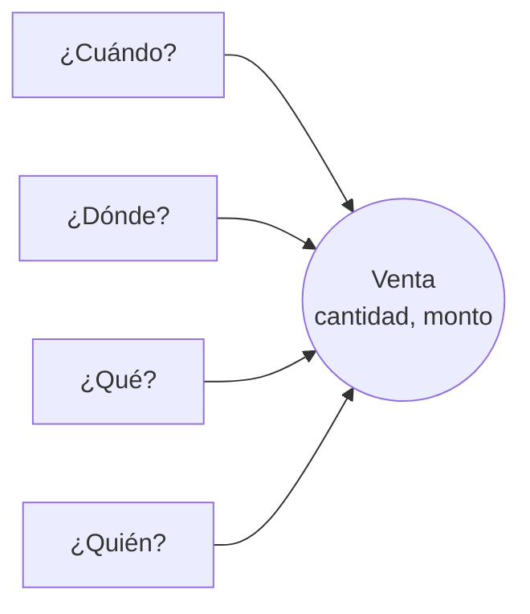
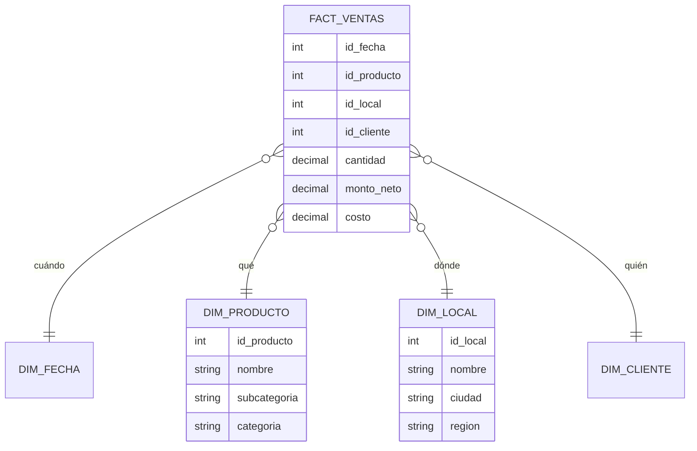
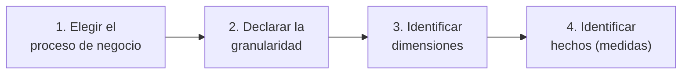

# Modelado dimensional: cómo diseñar datos que respondan preguntas de negocio

## Ficha de la clase

| Campo | Detalle |
|---|---|
| Tema | Modelado dimensional: hechos, dimensiones y esquema estrella |
| Duración | 90 minutos |
| Nivel | Intermedio |
| Conocimientos previos | SQL básico (SELECT, JOIN, GROUP BY); diferencia entre OLTP y OLAP |
| Materiales | Proyector, pizarra o tablero colaborativo, enunciado del ejercicio impreso o compartido |

## Objetivos de aprendizaje

Al terminar la clase, cada participante podrá:

1. Explicar por qué un modelo normalizado (3FN) dificulta el análisis y cómo el modelo dimensional lo resuelve.
2. Distinguir en un caso de negocio qué datos son hechos (medidas) y cuáles son dimensiones (contexto).
3. Diseñar un esquema estrella a partir de un proceso de negocio, definiendo explícitamente su granularidad.
4. Decidir entre esquema estrella y copo de nieve según el caso, justificando el costo de cada opción.

## Agenda

| Bloque | Minutos | Actividad | Propósito |
|---|---|---|---|
| 1. Apertura | 10 | Caso del reporte que nadie entiende | Generar la necesidad |
| 2. Intuición | 15 | Analogía del ticket de supermercado | Anclar en lo conocido |
| 3. Profundidad | 25 | Hechos, dimensiones, granularidad, estrella vs copo | Construir el modelo mental |
| 4. Práctica | 25 | Diseño en grupos de un esquema estrella | Aplicar y decidir |
| 5. Errores | 5 | Antipatrones frecuentes | Prevenir fallos reales |
| 6. Cierre | 10 | Ronda Feynman y verificación | Consolidar y comprobar |

## 1. Apertura: el problema (10 min)

Una cadena de farmacias con 120 locales quiere saber: *¿cuánto vendimos por categoría de producto, por región y por mes, comparado con el año anterior?*

El sistema transaccional (ERP) guarda los datos en más de 40 tablas normalizadas: `factura`, `detalle_factura`, `producto`, `subcategoria`, `categoria`, `local`, `ciudad`, `provincia`, `region`, `cliente`… La consulta que responde esa pregunta tiene 9 JOIN, tarda 14 minutos y, cuando la ejecutan dos analistas distintos, los totales no coinciden porque uno filtró las facturas anuladas y el otro no.

**Pregunta detonante para el grupo:** *¿Alguna vez un reporte de su empresa dio números distintos según quién lo hizo? ¿Por qué creen que pasó?*

Recoge 2 o 3 respuestas. El objetivo es que el grupo llegue a la idea de que el problema no es el SQL, sino que el modelo de datos fue diseñado para *registrar* transacciones, no para *analizarlas*.

## 2. Construyendo la intuición (15 min)

### La analogía: el ticket de supermercado

Piensa en un ticket de compra. Tiene números que se pueden sumar (cantidad, precio, total) y alrededor de esos números hay contexto que responde preguntas: *¿cuándo?* (fecha y hora), *¿dónde?* (local), *¿qué?* (producto), *¿quién?* (cliente, cajero).

- Los **números sumables** son los **hechos**.
- Las **preguntas de contexto** (cuándo, dónde, qué, quién) son las **dimensiones**.

El modelo dimensional organiza los datos exactamente así: una tabla central con los números y, alrededor, tablas con el contexto por el que queremos filtrar y agrupar.

Observa que todas las preguntas apuntan al mismo evento central: la venta. Esa es la forma de "estrella".

**Dónde falla la analogía:** un ticket es un documento completo, pero en el modelo dimensional hay que decidir qué representa *una fila* de la tabla de hechos: ¿el ticket entero o cada producto del ticket? Esa decisión, la **granularidad**, es la más importante del diseño y la veremos a continuación.

## 3. El concepto en profundidad (25 min)

### Los componentes

- **Tabla de hechos:** registra eventos medibles del negocio. Contiene medidas numéricas (monto, cantidad, costo) y claves que apuntan a las dimensiones. Suele ser larga (millones de filas) y angosta.
- **Tablas de dimensión:** describen el contexto. Contienen atributos descriptivos (nombre del producto, categoría, región, día de la semana). Son anchas y relativamente cortas.
- **Granularidad (grain):** la definición exacta de qué representa una fila de hechos. Ejemplo: *"una fila por cada producto vendido en cada factura"*. Se define **antes** de elegir medidas y dimensiones.
- **Clave subrogada:** identificador numérico propio del data warehouse (por ejemplo `id_producto_dw`), independiente del código del sistema origen. Permite manejar historia y cambios de sistema.

### El esquema estrella del caso

Observa que `DIM_PRODUCTO` contiene subcategoría y categoría en la misma tabla: se desnormalizó a propósito. Ahora la pregunta del inicio necesita solo 3 JOIN y cualquier analista obtiene el mismo resultado.

### El proceso de diseño en cuatro pasos (Kimball)

El orden importa: si eliges las medidas antes de la granularidad, terminarás mezclando datos de distinto nivel (por ejemplo, el total de la factura junto al monto de cada producto) y sumando de más.

### Estrella vs copo de nieve

| Criterio | Esquema estrella | Copo de nieve |
|---|---|---|
| Estructura | Dimensiones desnormalizadas, una tabla por dimensión | Dimensiones normalizadas en varias tablas (producto → subcategoría → categoría) |
| Facilidad de consulta | Alta: pocos JOIN, intuitivo para analistas y herramientas de BI | Menor: más JOIN, más difícil de entender |
| Rendimiento analítico | Generalmente mejor | Puede ser menor por los JOIN adicionales |
| Almacenamiento | Repite datos en las dimensiones | Ahorra espacio |
| Cuándo usarlo | La opción por defecto para analítica y BI | Dimensiones enormes con jerarquías que cambian a menudo, o reglas corporativas que lo exigen |
| Costo o riesgo | Más esfuerzo en el proceso de carga para mantener la desnormalización | Modelos difíciles de usar que terminan evitándose |

### En la industria

Este modelo, popularizado por Ralph Kimball en *The Data Warehouse Toolkit*, sigue siendo la base de la capa de consumo en la mayoría de plataformas analíticas actuales. En un data warehouse en la nube como Snowflake, BigQuery o Amazon Redshift, o en la capa *gold* de un lakehouse sobre Databricks, los equipos construyen tablas `fact_` y `dim_` con herramientas de transformación como dbt, y las exponen a Power BI, Tableau o Looker. Power BI, por ejemplo, está optimizado para trabajar con modelos en estrella; sus guías de modelado lo recomiendan explícitamente. El almacenamiento barato de la nube redujo el argumento a favor del copo de nieve basado en ahorrar espacio, por lo que hoy la estrella es todavía más claramente la opción por defecto.

## 4. Práctica activa (25 min)

### Enunciado

Formen grupos de 3 o 4 personas. Una empresa de transporte interprovincial de pasajeros quiere analizar:

- Ingresos por ruta, por mes y por tipo de bus.
- Ocupación promedio de los viajes.
- Qué canal de venta (ventanilla, web, app) genera más boletos por ruta.

El sistema origen registra cada **boleto vendido** con: fecha de venta, fecha del viaje, ruta (origen y destino), bus (placa, tipo, capacidad), canal, precio pagado y descuento aplicado.

### Entregable (15 min de trabajo, 10 min de puesta en común)

1. Granularidad declarada en una frase.
2. Lista de dimensiones con 3 atributos cada una.
3. Lista de medidas de la tabla de hechos.
4. El esquema dibujado en pizarra o tablero.
5. Una decisión justificada: ¿cómo calcularían la ocupación?

### Solución de referencia (para el docente)

- **Granularidad:** una fila por cada boleto vendido.
- **Dimensiones:** `dim_fecha` usada dos veces con distinto rol (fecha de venta y fecha de viaje: *role-playing dimension*); `dim_ruta` (origen, destino, distancia en km); `dim_bus` (placa, tipo, capacidad); `dim_canal` (nombre, tipo: presencial o digital).
- **Medidas:** precio pagado, descuento, cantidad de boletos (siempre 1, útil para contar).
- **Ocupación:** es la pregunta trampa. No se puede sumar desde la tabla de boletos, porque la capacidad del bus es un atributo del viaje, no del boleto. La solución sólida es una segunda tabla de hechos con granularidad *una fila por viaje* (`fact_viajes`) con boletos vendidos y capacidad, y calcular ocupación = boletos / capacidad. Esto introduce la idea de que un data warehouse tiene varias tablas de hechos que comparten dimensiones (*dimensiones conformadas*).

Durante la puesta en común, pide a un grupo que haya puesto la ocupación en la tabla de boletos que explique cómo la sumaría; el error se hace evidente solo.

## 5. Errores comunes y antipatrones (5 min)

1. **No declarar la granularidad:** mezclar en una misma tabla el total de la factura y el detalle por producto. Resultado: totales duplicados.
2. **Usar las claves del sistema origen como claves del warehouse:** cuando el ERP cambia o recicla códigos, la historia se rompe.
3. **Normalizar las dimensiones por costumbre:** traer el diseño 3FN del sistema transaccional y llamarlo "data warehouse".
4. **Meter atributos descriptivos en la tabla de hechos:** nombres de productos o regiones dentro de `fact_ventas` en lugar de en su dimensión.
5. **Una tabla gigante para todo (*one big table*) sin criterio:** útil en casos puntuales, pero sin granularidad clara reproduce el problema inicial.

## 6. Cierre y verificación (10 min)

### Ronda Feynman (4 min)

En parejas, cada persona tiene 2 minutos para explicarle a su compañero, como si este fuera del área comercial y no supiera nada de datos, qué es un esquema estrella y por qué la empresa lo necesita. Prohibido usar las palabras "normalización" y "tabla de hechos".

### Preguntas de verificación (5 min)

1. *Una tienda en línea registra cada clic de los usuarios. ¿Qué granularidad propondrías para analizar el embudo de compra?* Respuesta esperada: una fila por evento de clic (o por sesión, si se analiza a ese nivel), justificando que la granularidad sigue a la pregunta de negocio.
2. *¿El "precio de lista" del producto es una medida o un atributo de dimensión?* Respuesta esperada: atributo de `dim_producto`; la medida es el precio efectivamente pagado en la transacción.
3. *Tu equipo propone un copo de nieve para ahorrar espacio en BigQuery. ¿Qué respondes?* Respuesta esperada: el ahorro de almacenamiento suele ser irrelevante frente al costo de consultas más complejas y menos usables; la estrella es la opción por defecto.
4. *¿Por qué una misma `dim_fecha` puede aparecer dos veces en un esquema?* Respuesta esperada: porque cumple distintos roles (fecha de venta, fecha de viaje).

### Idea clave (1 min)

> Los sistemas transaccionales se diseñan para escribir datos sin errores; el modelo dimensional se diseña para que cualquiera pueda leerlos y obtener la misma respuesta.

## Notas para el docente

- **Confusión frecuente:** confundir granularidad con "nivel de detalle del reporte". Insiste en que la granularidad es de la tabla, no del reporte: un reporte mensual puede salir de una tabla diaria, pero no al revés.
- **Pregunta difícil probable:** *"¿Esto no está obsoleto con los lakehouses?"* Respuesta: el lakehouse cambia dónde y cómo se almacenan los datos, no la necesidad de un modelo comprensible para el consumo; la capa *gold* suele modelarse dimensionalmente.
- **Si vas corto de tiempo:** reduce la puesta en común a dos grupos y deja la pregunta 4 como tarea.
- **Si te sobra tiempo:** introduce las dimensiones lentamente cambiantes (SCD) preguntando qué pasa si un local cambia de región. Es el puente natural a la siguiente clase.

## Para profundizar

- Ralph Kimball y Margy Ross, *The Data Warehouse Toolkit*, 3.ª edición (Wiley). Capítulos 1 a 3.
- Documentación de Microsoft sobre esquema estrella en Power BI ("Understand star schema and the importance for Power BI").
- Documentación de dbt sobre modelado dimensional y buenas prácticas de estructura de proyectos.
